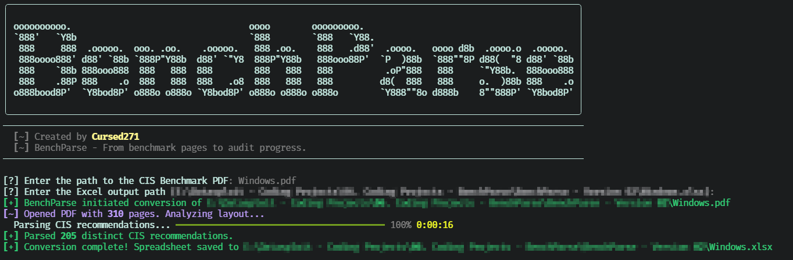
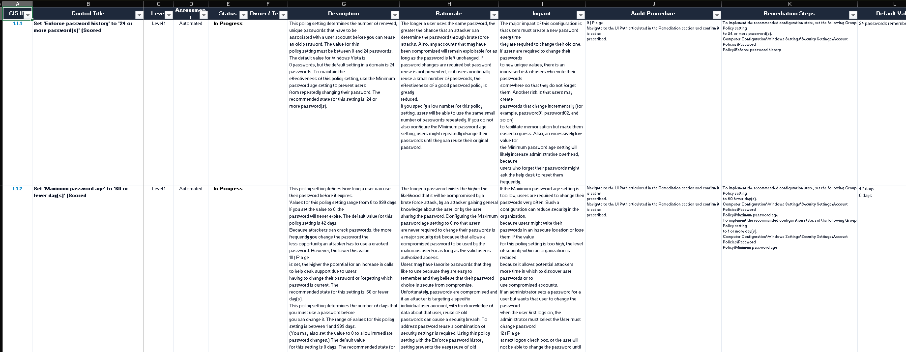

<div align="center">

  

  <h1>BenchParse</h1>

  <p align="center">
    
  </p>

  <p align="center">
    
    
    
    
    <a href="./LICENSE">
      
    </a>
  </p>

  <p>From Benchmark Pages to Audit Progress.</p>

</div>


## Overview

BenchParse is a Python utility that extracts CIS Benchmark recommendations from PDF documents and converts them into a structured Excel compliance workbook.

It identifies recommendation IDs, titles, profile levels, assessment methods, and core control sections, then creates an audit-ready matrix with status tracking, owner fields, and an executive scorecard.

> BenchParse performs document parsing and workflow generation. It does not assess a system, validate a control, or determine compliance by itself.

## Features

| Capability | What it does |
| :--- | :--- |
| PDF parsing | Uses pdfplumber to extract layout-aware text from CIS Benchmark PDFs. |
| Recommendation detection | Identifies numbered CIS control IDs and validates them through nearby `Profile Applicability` sections. |
| Control metadata | Extracts control ID, title, profile level, and assessment method. |
| Section extraction | Captures Profile Applicability, Description, Rationale, Impact, Audit, Remediation, Default Value, References, and CIS Controls. |
| Duplicate suppression | Removes repeated recommendations using control ID and title. |
| Excel matrix | Creates a formatted `CIS Compliance Matrix` worksheet. |
| Audit workflow | Adds status, owner, and auditor-notes fields with a compliance-status dropdown. |
| Executive scorecard | Adds a summary sheet showing the total number of parsed controls. |
| Safe output handling | Uses temporary-file writing and prevents accidental overwrite unless `--overwrite` is supplied. |

## Screenshots:

### Interface


### Output


## Technology

| Component | Purpose |
| :--- | :--- |
| Python | Application runtime |
| Typer | Command-line options and help |
| Rich | Banner, prompts, progress display, and terminal output |
| pdfplumber | PDF text and layout extraction |
| openpyxl | Excel workbook creation, formatting, validation, and export |
| pathlib | File-path handling |
| re | CIS recommendation and section parsing |

## Installation

### Prerequisites

- Python 3 with `pip`.
- A text-based CIS Benchmark PDF.
- Write access to the selected output directory.

Install dependencies:

```bash
python3 -m pip install rich typer pdfplumber openpyxl
```

Clone and display help:

```bash
git clone https://github.com/Cursed271/BenchParse.git
cd BenchParse
python3 BenchParse.py --help
```

Use an isolated Python environment. If your environment uses `python` rather than `python3`, substitute that interpreter consistently.

## Usage

### Interactive Conversion

```bash
python3 BenchParse.py
```

BenchParse prompts for the CIS Benchmark PDF path and Excel output path.

### Direct Conversion

```bash
python3 BenchParse.py -i "CIS_Microsoft_Windows_11_Benchmark.pdf" -o "Windows_11_Audit.xlsx"
```

### Overwrite an Existing Report

```bash
python3 BenchParse.py -i benchmark.pdf -o audit.xlsx --overwrite
```

## Command-Line Options

| Option | Short | Default | Purpose |
| :--- | :--- | :--- | :--- |
| `--input` | `-i` | Interactive prompt | Path to the CIS Benchmark PDF |
| `--output` | `-o` | Input filename with `.xlsx` | Excel report destination |
| `--overwrite` | — | Disabled | Permit replacement of an existing Excel file |
| `--help` | `-h` | — | Show help |

The input must be an existing, readable `.pdf` file. The output must use the `.xlsx` extension and cannot replace the source PDF.

## Excel Output

### CIS Compliance Matrix

The primary worksheet contains one row per detected recommendation.

| Column | Purpose |
| :--- | :--- |
| CIS ID | Benchmark recommendation identifier |
| Control Title | Extracted recommendation title |
| Level | Profile Level 1 or Level 2 |
| Assessment | Automated or Manual |
| Status | Editable compliance status dropdown |
| Owner Team | Assessment ownership field |
| Description | Extracted recommendation description |
| Rationale | Extracted rationale |
| Impact | Extracted impact guidance |
| Audit Procedure | Extracted audit guidance |
| Remediation Steps | Extracted remediation guidance |
| Default Value | Extracted default configuration |
| Auditor Notes / Artifacts | Evidence and reviewer notes |

### Compliance Status Values

The Status column provides the following dropdown values:

- `Compliant`
- `Non-Compliant`
- `Exception`
- `In Progress`
- `Not Applicable`

### Executive Summary

The `Executive Summary` worksheet displays the total number of distinct CIS recommendations parsed from the source PDF.

## Parsing Behavior

BenchParse looks for recommendation identifiers followed by a `Profile Applicability` section within a limited lookahead window. It removes common page headers, footers, and CIS website references before parsing.

The parser stops processing a page when it reaches:

- `Appendix: Summary Table`
- `Appendix: Change Log`

Level and assessment tags are removed from titles before the final title is written to Excel.

## Known Limitations

- Parsing quality depends heavily on the PDF's text layout and formatting.
- Scanned or image-only PDFs are not supported.
- Complex tables, multi-column layouts, and unusual benchmark editions may produce incomplete or malformed records.
- The parser is tuned toward common CIS Benchmark section labels and may miss variant formats.
- The executive scorecard reports parsed-control count, not compliance status or completion percentage.
- No OCR, password-protected PDF handling, or PDF-to-image conversion is implemented.
- The output is a working audit tracker, not an automated compliance verdict.

## Safe Use

- Use official or authorized copies of CIS Benchmark PDFs.
- Review extracted records before using them in formal assessment documentation.
- Preserve evidence, screenshots, commands, and configuration exports separately from the workbook.
- Do not treat a parsed control as assessed until an owner completes validation.
- Protect workbooks containing internal system names, configurations, and assessment findings.

## Troubleshooting

| Problem | What to check |
| :--- | :--- |
| No recommendations found | Whether the PDF is scanned, encrypted, or uses an unsupported layout |
| Missing sections | PDF text extraction quality and benchmark edition formatting |
| Incorrect titles or levels | Source PDF layout and parser assumptions |
| Output rejected | `.xlsx` extension, path validity, and existing-file overwrite setting |
| Excel save fails | Output-directory permissions and available disk space |
| Slow processing | PDF page count and system resources |

## Version History

| Version | Scope |
| :--- | :--- |
| Version 1 | CIS Benchmark PDF parsing, Excel compliance matrix generation, audit fields, and executive summary |


## License & Usage

BenchParse is distributed under the CursedSec Ownership Edict (COE).

Read [LICENSE](./LICENSE) for the applicable permissions, restrictions, contribution terms, and disclaimers. Public source availability is not a substitute for those terms.

## Feedback & Contributions

Use the repository's bug-report or feature-request template when issue submission is available.

Include the version, operating system, command, sanitized output, and reproduction steps. Never publish client scan results, credentials, sensitive infrastructure details, or evidence containing confidential data.

Check the security-reporting instructions before disclosing a vulnerability. Review the license and contribution terms before submitting modifications.

## Connect & Collaborate

<div align="center">

  <a href="https://github.com/Cursed271">
    
  </a>
  <a href="https://www.cursedsec.com/">
    
  </a>
  <a href="https://www.linkedin.com/in/cursed271/">
    
  </a>

  <p>Parse the benchmark. Track the control. Prove the outcome.</p>
  <sub>CursedSec.com · Cursed271 · BenchParse</sub>

</div>


